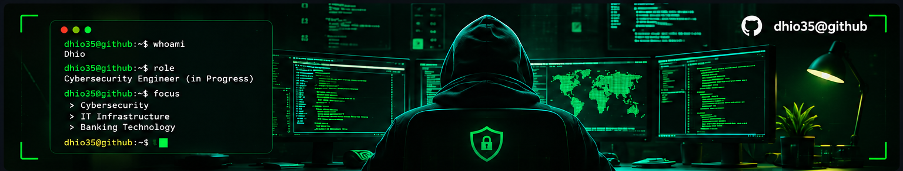

# 🛡️ DHIO35 | Cybersecurity & IT Engineering

  

<h1 align="center">Hi, I'm Dhio 👋</h1>

<h3 align="center">Cybersecurity Engineer in Progress</h3>

  IT Infrastructure • Information Security • Banking Technology

  Building secure systems, exploring cybersecurity, and continuously learning through hands-on projects.

  
  
  

---

## 👨‍💻 About Me

I'm an IT enthusiast currently developing my expertise in **Cybersecurity, IT Infrastructure, and Banking Technology**.

With an IT Support background and experience in Data Analytics, I'm passionate about understanding how technology works, solving technical problems, and building secure and reliable systems.

- 🔭 **Currently working on:** PT Bank Negara Indonesia (BNI) as an IT Officer Development Program (ODP) participant.
- 🌱 **Currently learning:** Cybersecurity, Network Security, Linux, Cloud Computing, and Security Operations.
- 👯 **Looking to collaborate on:** Cybersecurity projects, IT automation, open-source tools, and infrastructure solutions.
- 🤔 **Looking for help with:** SIEM implementation, Threat Detection, Security Engineering, and Cloud Security.
- 💬 **Ask me about:** IT Infrastructure, IT Support, Banking Technology, Data Analytics, and Python.
- 📚 **Currently exploring:** SOC Operations, SIEM, Vulnerability Management, and Security Automation.
- 🎯 **Career goal:** Growing into a Cybersecurity Engineer and eventually a Security Architect.
- ⚡ **Fun fact:** I believe every problem is an opportunity to learn something new.

---

## 🛡️ Areas of Interest

- 🔐 Cybersecurity & Information Security
- 🖥️ Security Operations Center (SOC)
- 📊 Security Information and Event Management (SIEM)
- 🌐 Network & Infrastructure Security
- ☁️ Cloud Security & DevSecOps
- 🏦 Banking Technology & Digital Transformation
- 🤖 IT Automation & Data Analytics

---

## 💻 Tech Stack & Tools

### Programming & Data

  
  
  
  

### Infrastructure & Development

  
  
  
  
  

### Data Engineering & Automation

  
  
  

---

## 📊 GitHub Analytics

  
  

  

---

## 🚀 What I'm Building

I'm continuously exploring and building projects to strengthen my technical skills.

Some areas I'd love to develop projects in:

- 🔐 SIEM & Security Monitoring Lab
- 🌐 Network Monitoring & Analysis
- 🐧 Linux Administration & Hardening
- 🤖 Python Security Automation
- 📊 Data Analytics & Visualization
- ☁️ Cloud Infrastructure & Security

Check out my repositories to see what I'm learning and building!

---

## 🎯 My Philosophy

> Stay curious. Keep learning. Build things that matter.

I believe that becoming a great engineer is not just about knowing technologies, but also about understanding problems, thinking critically, and continuously improving.

---

  <b>Thanks for visiting my profile!</b>
   
  Let's connect, learn, and build something meaningful. 🚀

  <i>dhio35@github:~$ Keep learning, keep building.</i>

